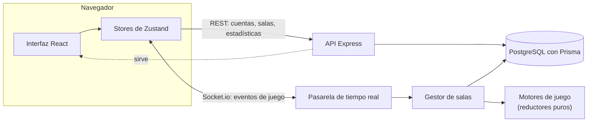

# PokeMiniGames

**Minijuegos Pokémon en tiempo real para dos personas: reta a un amigo 1 vs 1 desde el navegador.**

[](https://github.com/marcovinir/pokeminigames/actions/workflows/ci.yml)
[](https://pokemon-minigames.onrender.com)

[](LICENSE)

**[▶ Jugar en vivo](https://pokemon-minigames.onrender.com)** · [Read in English](README.md) · [Guía técnica](docs/guia-tecnica.md)

> La capa gratuita del alojamiento se duerme si nadie entra: la primera visita puede tardar hasta un minuto en despertar el servidor.


## Los juegos

| | |
|---|---|
| **Doble tipo** | En cada ronda aparece un par de tipos. Los dos jugadores tienen 15 segundos para nombrar un Pokémon que tenga ambos; gana quien sume más stats base. |
| **¿Quién es ese Pokémon?** | Los dos ven la misma silueta y tienen un solo intento. Cuanto antes aciertes, más puntos. Se eligen las generaciones con las que jugar. |

Crea una sala, pásale el código a un amigo y a jugar. Sin cuenta (modo invitado), o con una cuenta para tener perfil, estadísticas, historial y un Pokémon de avatar. Al terminar, pide la **revancha** con la misma configuración.

| | |
|---|---|
|  |  |
|  |  |


## Lo más destacado

- **Multijugador en tiempo real** con Socket.io y un motor de juego que manda en el servidor, escrito como un **reductor puro** (`estado + evento → estado + efectos`): cada regla se prueba con un reloj simulado.
- **Aguanta reconexiones:** si recargas en plena ronda vuelves a tu asiento; quien se desconecta tiene un tiempo de gracia.
- **Anti-trampas desde el diseño:** la silueta se dibuja en el servidor como un PNG negro tras un token aleatorio, así que la respuesta nunca llega al navegador.
- **Cuentas hechas con cuidado:** token de acceso corto y solo en memoria, cookie de refresco `HttpOnly` que rota, límites por IP, comprobación de origen, y borrar la cuenta la anonimiza sin tocar el historial de los rivales.
- **Sonido:** música chiptune original y de licencia libre para la sala, el combate y el final, y efectos de 8 bits generados en el navegador con la Web Audio API (sin archivos de audio), con un panel para silenciar y ajustar el volumen.
- **Interfaz accesible:** dos temas (Clásico y Pokédex) en claro y oscuro, contraste WCAG AA comprobado en las pruebas y en un navegador real, foco de teclado visible y una sola regla que respeta *reducir movimiento*.

## Tecnologías

| Capa | Herramientas |
|---|---|
| Cliente | React 19, Vite, Tailwind CSS 4, Zustand, React Router |
| Servidor | Node.js 24, Express 5, Socket.io, Prisma 7, PostgreSQL 18, Zod |
| Compartido | Paquete de TypeScript con el contrato de eventos, los códigos de error y utilidades que usan los dos lados |
| Pruebas | Vitest + Testing Library, Playwright de extremo a extremo con dos navegadores reales |
| Entrega | CI en GitHub Actions, Render (servicio web) + Neon (Postgres), los dos en capa gratuita |

## Arquitectura



Un solo servicio de Node sirve el cliente construido, la API REST y Socket.io desde el mismo origen (sin CORS, cookies `SameSite=Lax`). El estado de las partidas vive en memoria tras la interfaz `RoomStore`; las partidas terminadas se guardan para las estadísticas.

## Cómo se construyó

- **Spec → plan → TDD → revisión independiente.** Cada función empieza con una spec de diseño y un plan de implementación, en [`docs/superpowers/`](docs/superpowers/). Cada paso se escribe con la prueba primero, las protecciones críticas se comprueban rompiéndolas a propósito (pruebas de mutación) y cada rama pasa una revisión final con ojos nuevos antes de fusionarse.
- **Unas 1800 pruebas automáticas** (servidor y cliente) y **44 pruebas E2E con Playwright** que juegan partidas completas en navegadores reales contra la construcción de producción, incluidas comprobaciones de diseño a ancho de teléfono.
- **El trabajo se sigue en [issues de GitHub](https://github.com/marcovinir/pokeminigames/issues)** con una hoja de ruta, y los cambios entran por Pull Requests con la CI en verde.
- **Desarrollo asistido por IA:** hecho con Claude Code como compañero de programación. [`AGENTS.md`](AGENTS.md) recoge el flujo de trabajo y las reglas que sigue quien contribuya, persona o agente.

## Ejecutarlo en local

Requisitos: Node.js 24 o superior y PostgreSQL 18 (sin Docker).

```bash
npm install
cp server/.env.example server/.env          # luego pon DATABASE_URL y JWT_ACCESS_SECRET
npm run db:migrate -w server && npm run db:seed -w server
npm run dev          # servidor del juego en http://localhost:3000
npm run dev:client   # cliente web en http://localhost:5173
```

```bash
npm test             # pruebas del servidor y del cliente
npm run typecheck    # tsc en todos los paquetes
npm run e2e          # construye y corre las pruebas de Playwright
```

La puesta en marcha completa, todos los comandos, la API REST y los eventos de Socket.io están en la [guía técnica](docs/guia-tecnica.md); el despliegue en Render y Neon, en [`docs/despliegue.md`](docs/despliegue.md).

## Estructura

| Carpeta | Qué hay |
|---|---|
| `client/` | Cliente web |
| `server/` | API REST, pasarela de tiempo real, motores de juego, esquema y migraciones de Prisma |
| `shared/` | Contrato de eventos y tipos compartidos por cliente y servidor |
| `e2e/` | Pruebas de extremo a extremo con Playwright |
| `docs/` | Guía técnica, guía de despliegue, specs de diseño y planes |

## Licencia

El código se publica con la [licencia MIT](LICENSE).

PokeMiniGames es un **proyecto de fans** sin fines de lucro. Pokémon y sus personajes son marcas de Nintendo, Game Freak y The Pokémon Company; no hay relación con ellos ni respaldo suyo. El arte y los datos de los Pokémon salen de [PokeAPI](https://pokeapi.co).
