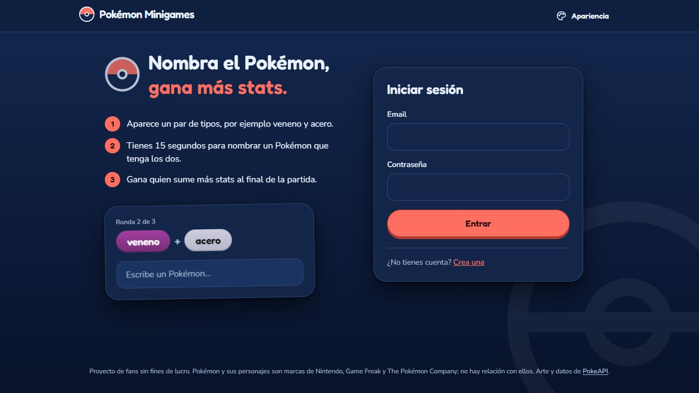
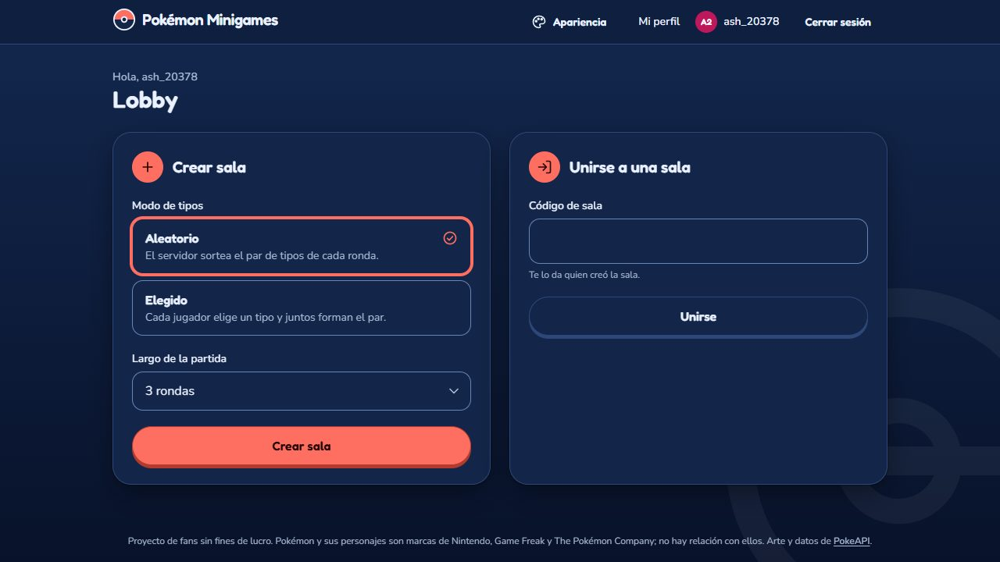
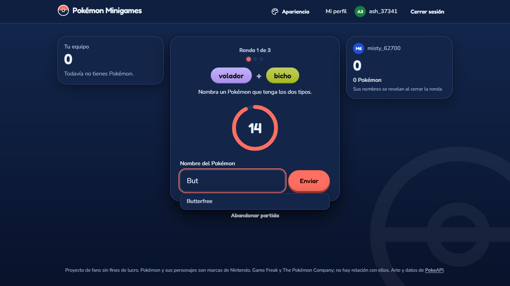
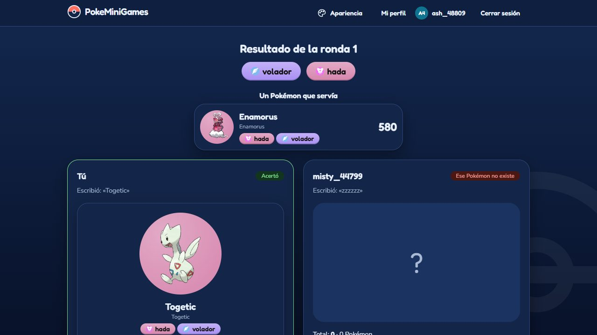
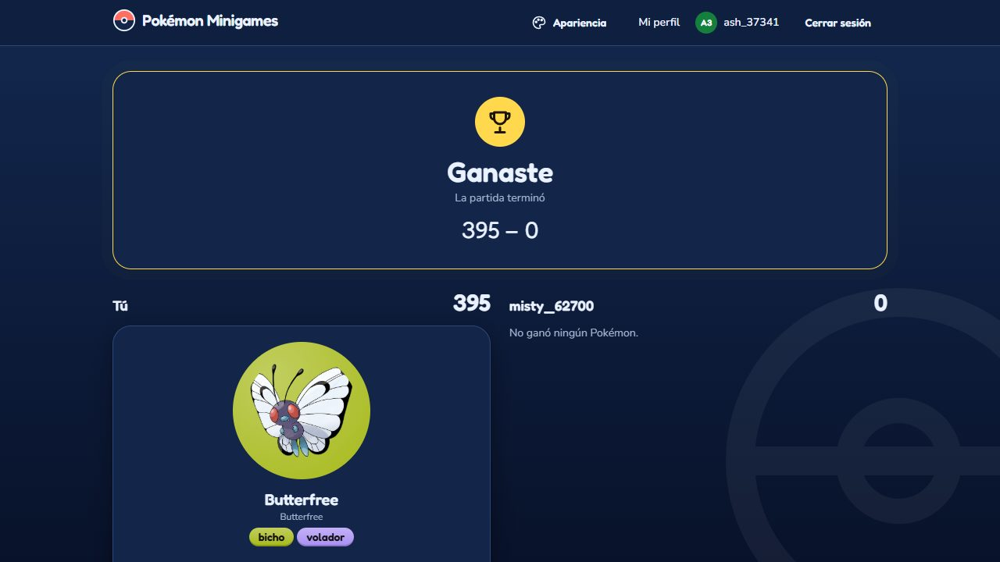
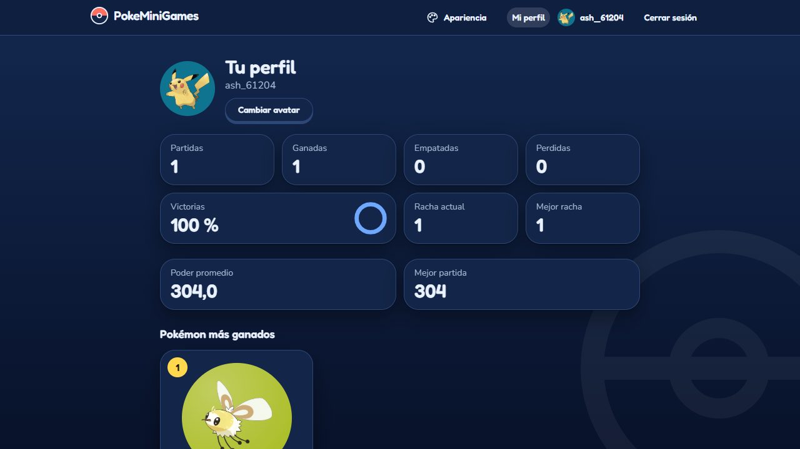
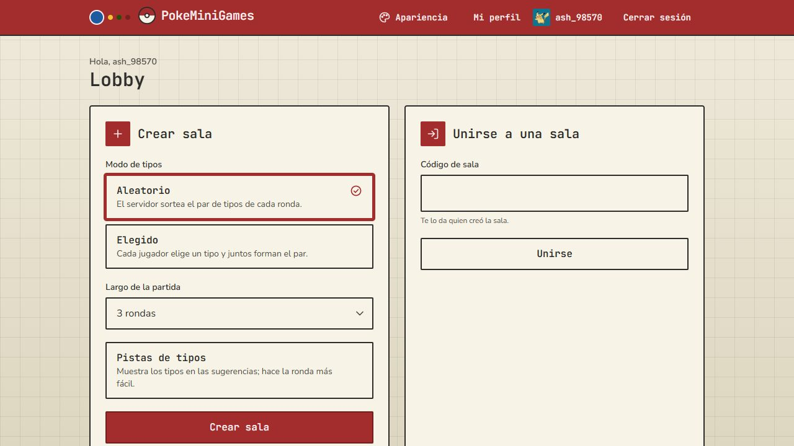

# Pokémon Minigames

Juego web de 2 jugadores en tiempo real: en cada ronda se enfrenta un par de tipos Pokémon y cada jugador tiene 15 s para nombrar un Pokémon que tenga ambos. Gana quien acumule más stats base. El diseño completo está en [`docs/superpowers/specs/`](docs/superpowers/specs/).

**Estado:** etapa 8 (pulido de la partida) completa sobre el juego de las etapas 1 a 7: servidor, cliente web, estadísticas, perfil, el rediseño visual de la etapa 6 (temas incluidos) y las cuentas con código por correo de la etapa 7. Listo para desplegarse gratis en Render y Neon: la guía está en [`docs/despliegue.md`](docs/despliegue.md).

## Capturas

Tema Clásico oscuro, en un navegador de 1280 × 720 (las genera la prueba `e2e/tests/screenshots.spec.ts`).















## Estructura

| Carpeta | Contenido |
|---|---|
| `server/` | API REST (Express) y tiempo real (Socket.io), motor de juego, Prisma y PostgreSQL |
| `client/` | Cliente web: React 19, Vite, Tailwind, Zustand y React Router |
| `shared/` | Tipos de eventos, payloads, códigos de error y `normalizeName`, compartidos por servidor y cliente |
| `e2e/` | Prueba de extremo a extremo con Playwright: dos navegadores reales juegan contra la construcción de producción |

## Requisitos

- Node 24 o superior
- PostgreSQL 18 (local, sin Docker)

## Puesta en marcha

```bash
npm install
```

1. Crea dos bases de datos: `pokemon_minigames` y `pokemon_minigames_test`.
2. Copia `server/.env.example` a `server/.env` y `server/.env.test.example` a `server/.env.test`; completa las credenciales de PostgreSQL y `JWT_ACCESS_SECRET` (mínimo 32 caracteres).
3. Aplica las migraciones y carga el catálogo:

```bash
npm run db:migrate -w server
npm run db:seed -w server
```

4. Arranca el servidor del juego (`http://localhost:3000`) y, en otra terminal, el cliente (`http://localhost:5173`):

```bash
npm run dev
npm run dev:client
```

Las cuentas con código por correo (verificar el correo al registrarse y «olvidé mi contraseña») vienen apagadas. Para probarlas en tu máquina pon `EMAIL_VERIFICATION=on` en `server/.env`: sin proveedor de correo, los mensajes se imprimen en la consola del servidor (`MAIL_PROVIDER=console`).

En desarrollo el servidor de Vite hace de proxy de `/auth`, `/rooms`, `/pokemon`, `/stats`, `/users` y `/socket.io` al servidor del juego, de modo que cliente y API comparten origen y la cookie de sesión funciona. Abre `http://localhost:5173`, crea una cuenta y una sala; para jugar necesitas un segundo jugador (otro navegador o una ventana privada, con otra cuenta).

## Comandos

| Comando | Qué hace |
|---|---|
| `npm run dev` | Servidor del juego en modo desarrollo con recarga |
| `npm run dev:client` | Cliente web con recarga en caliente |
| `npm run build` | Construye el cliente (`client/dist`) y empaqueta el servidor (`server/dist/index.js`) |
| `npm start` | Arranca la construcción de producción (necesita las variables de `NODE_ENV=production`, ver la guía de despliegue) |
| `npm run e2e` | Construye y ejecuta las pruebas E2E (una partida completa, recargar en plena ronda, el límite de login, las cuentas con código por correo, el tema y, en un navegador real, el diseño en móvil, el foco del teclado, el movimiento, las tipografías y el pulido de la partida: iconos de tipo, sugerencias con y sin pistas, el ejemplo tras la ronda y el equipo del rival): crea su propia base de datos, la borra al terminar |
| `npm test` | Todas las pruebas: servidor (usan la base `pokemon_minigames_test`) y cliente |
| `npm run typecheck` | Verifica los tipos con `tsc` en todos los paquetes |
| `npm run db:migrate -w server` | Crea/aplica migraciones en desarrollo |
| `npm run db:seed -w server` | Carga el catálogo desde `server/data/catalog.snapshot.json` |
| `npm run catalog:fetch -w server` | Vuelve a descargar el catálogo de PokéAPI al snapshot |
| `npm run smoke -w server` | Juega una partida real de una ronda contra el servidor en marcha |
| `npm run smoke:deployed -- URL` | Comprueba un despliegue en internet sin escribir nada (despierta el servicio si hace falta) |

Variable opcional del cliente: `VITE_API_URL` (URL base del servidor; vacía = el mismo origen).

## Producción y pruebas E2E

El servidor sirve el cliente construido, la API y Socket.io desde un solo origen, así que en producción no hay CORS y la cookie de sesión es `Secure` + `SameSite=Lax`. Las peticiones que cambian algo se rechazan si vienen de otro origen (403 `FORBIDDEN`) y hay límites por IP en memoria: 5 intentos de login fallidos cada 15 minutos por IP y correo (y 30 por IP sumando todos los correos), 5 registros por hora y 300 peticiones por minuto a la API (429 `RATE_LIMITED` con `Retry-After`). Cómo desplegarlo, qué esperar de la capa gratuita y cómo comprobarlo: [`docs/despliegue.md`](docs/despliegue.md). Cómo activar las cuentas con código por correo en el sitio en vivo (dominio, Resend, variables de Render y marcha atrás): [`docs/correo.md`](docs/correo.md).

`npm run e2e` necesita Chromium: `npx playwright install chromium` desde `e2e/`, o define `E2E_CHANNEL=msedge` (o `chrome`) para usar el navegador ya instalado. Con `E2E_ADMIN_DATABASE_URL` (o tu `server/.env`) crea la base `pokemon_minigames_e2e`. En GitHub, [`.github/workflows/ci.yml`](.github/workflows/ci.yml) corre tipos, pruebas, construcción y E2E en cada push a `main` y en cada pull request.

## Cuentas con código por correo

Con `EMAIL_VERIFICATION=on`, registrarse crea la cuenta pendiente y envía un código de 6 dígitos al correo (`/verificar`); sin escribirlo no se abre sesión. En el inicio de sesión aparece «¿Olvidaste tu contraseña?» (`/olvide` → `/restablecer`), que cambia la contraseña con otro código y cierra las sesiones abiertas. Un código dura 10 minutos, vale una vez y se bloquea tras 5 intentos; se guarda solo como huella (HMAC) y nunca se escribe en el registro; las respuestas no revelan si un correo tiene cuenta; hay límites de envío (un código por minuto por correo, 5 por hora por correo y 10 por hora por IP) y de intentos (5 cada 10 minutos por correo y 20 por hora por IP). Apagada (`off`, el valor de partida) la aplicación se comporta como antes y las rutas nuevas no existen.

Los correos los envía [Resend](https://resend.com) (`MAIL_PROVIDER=resend`, con `RESEND_API_KEY` y `MAIL_FROM`); en desarrollo, la consola del servidor, y en las pruebas, un buzón en memoria.

## Pulido de la partida

En **Elegir tipo** y en todos los chips de tipo se ve el icono oficial de cada tipo (el de PokeAPI, decorativo: el nombre sigue siendo el texto). En el campo de respuesta, cada sugerencia lleva el sprite del Pokémon, su número de Pokédex y los nombres en español e inglés. La opción de la sala **Pistas de tipos** (apagada por defecto, la elige quien crea la sala y vale para los dos) añade a cada sugerencia sus tipos, lo que vuelve la ronda mucho más fácil; sin ella los tipos ni viajan al navegador (`GET /pokemon/names` sin `?types=1`). Si en una ronda acierta 0 o 1 jugador, el servidor sortea entre los Pokémon de ese par que nadie tiene y lo muestra como «Un Pokémon que servía»; si aciertan los dos o no queda ninguno libre, no aparece. El panel del rival lista los Pokémon que ya ganó (nada que no se haya revelado antes en `round-result`), también tras recargar o reconectar.

## Estadísticas y perfil

En **Mi perfil** (`/perfil`) cada persona ve sus partidas jugadas, ganadas, empatadas y perdidas, el porcentaje de victorias, la racha actual y la mejor, sus 3 Pokémon más ganados, el poder promedio de los Pokémon que ganó, su mejor partida y el historial de sus partidas (con el motivo del fin: abandono, desconexión, etc.). Al terminar una partida se puede abrir el perfil del rival (`/jugador/:username`), que solo muestra estadísticas. Solo cuentan las partidas completadas; las abandonadas no. Todo se calcula al pedirlo a partir de las partidas guardadas (no hay tablas de estadísticas aparte).

## Temas y accesibilidad

Cada jugador elige entre dos temas, **Clásico** (moderno y colorido: esquinas muy redondeadas, relieve, fondo con degradado y tipografía Fredoka) y **Pokédex** (la piel retro del mismo diseño: bordes marcados, sin sombras difusas y letra monoespaciada JetBrains Mono), y entre modo automático, claro u oscuro desde el botón «Apariencia» del encabezado; la preferencia se guarda en el navegador y, con la sesión iniciada, también en tu perfil (al entrar en otro navegador se aplica la del perfil). Los colores de todos los temas y de los 18 tipos cumplen el contraste AA de WCAG (lo comprueban las pruebas). Para revisar lo que realmente se ve, pega [`client/scripts/contrast-audit.js`](client/scripts/contrast-audit.js) en la consola del navegador y ejecuta `__contrastAuditAll()`.

Las tipografías (Fredoka, Nunito y JetBrains Mono) se empaquetan con el proyecto (`@fontsource-variable`, solo los subconjuntos latino y latino extendido), sin pedir nada a servicios externos. Las animaciones son CSS puro y los números de los marcadores cuentan hasta su valor nuevo; si el sistema pide **reducir movimiento**, una sola regla apaga todas las animaciones y sus retardos y los números saltan directo al valor final. El diseño en pantallas estrechas se mide en un navegador de verdad (`e2e/tests/layout.spec.ts`: de 360 a 1280 px, con nombres de usuario de 30 letras), y el aro del foco del teclado se mide en los cuatro temas (`e2e/tests/focus.spec.ts`). El arte de cada Pokémon es el oficial de [PokeAPI](https://pokeapi.co) (solo donde hay pocas imágenes a la vez; en las listas, el sprite pequeño), con un esqueleto mientras carga y una bola neutra si falla. Este es un proyecto de fans sin fines de lucro: Pokémon y sus personajes son marcas de Nintendo, Game Freak y The Pokémon Company, y no hay relación con ellos.

Para regenerar las capturas de arriba: `E2E_SCREENSHOTS=1 npm run e2e -w e2e -- screenshots` (con `E2E_CHANNEL=msedge` si no instalaste Chromium); sin esa variable la prueba se omite.

## API REST

| Método y ruta | Descripción |
|---|---|
| `GET /health` | Estado del servidor |
| `GET /auth/options` | Público. `{ emailVerification }`: si la verificación por correo está activa (el cliente muestra «¿Olvidaste tu contraseña?» solo entonces) |
| `POST /auth/register` | Crea la cuenta; devuelve `user` (con su `preferences` de tema, nulas al principio) y `accessToken` y fija la cookie de refresco. Con la verificación activa no abre sesión: responde `202 { verification: "required", email }` y envía el código |
| `POST /auth/login` | Inicia sesión. Con la verificación activa, una cuenta sin verificar recibe `403 EMAIL_NOT_VERIFIED` (tras acertar la contraseña) y un código nuevo |
| `POST /auth/verify-email` | Solo con la verificación activa. `{ email, code }`: verifica el correo, abre la sesión y devuelve lo mismo que el login; `400 INVALID_CODE` ante cualquier fallo del código |
| `POST /auth/verification/resend` | Solo con la verificación activa. `{ email }`: envía un código nuevo; siempre `202 { ok: true }`, exista o no la cuenta |
| `POST /auth/password/forgot` | Solo con la verificación activa. `{ email }`: envía el código para cambiar la contraseña; siempre `202 { ok: true }` |
| `POST /auth/password/reset` | Solo con la verificación activa. `{ email, code, password }`: cambia la contraseña, cierra las demás sesiones y da el correo por verificado; `204` sin abrir sesión |
| `POST /auth/refresh` | Renueva la sesión con la cookie (rota el refresh token) |
| `POST /auth/logout` | Cierra la sesión y borra la cookie |
| `GET /auth/me` | Usuario actual |
| `PUT /auth/me/preferences` | Guarda el tema: `{ theme: "clasico" \| "pokedex", themeMode: "auto" \| "claro" \| "oscuro" }` |
| `POST /rooms` | Crea una sala: `{ typeMode: "random" \| "chosen", lengthMode: "fixed_rounds" \| "custom", roundsLimit?, statsGoal?, typeHints? }`; devuelve `{ code }`. `typeHints` (booleano, `false` por omisión) activa las «Pistas de tipos»: las sugerencias muestran los tipos de cada Pokémon |
| `GET /rooms/current` | La sala activa del usuario: `{ room: { code, phase } }` o `{ room: null }` |
| `GET /rooms/:code` | Información pública de la sala |
| `POST /rooms/:code/join` | Reserva el asiento 2 |
| `GET /pokemon/names` | Público. Lista de `{ id, es, en }` de todos los Pokémon, para el autocompletado; con `?types=1` cada elemento lleva además `types` (el cliente solo lo pide en salas con «Pistas de tipos») |
| `GET /stats` | Tus estadísticas: `{ username, stats }` |
| `GET /stats/history?limit=&before=` | Tus partidas completadas, de la más reciente a la más antigua (`limit` de 1 a 50, por defecto 20); `before` es el `nextCursor` de la página anterior. Devuelve `{ games, nextCursor }` |
| `GET /users/:username/stats` | Las estadísticas de otra persona (nunca su correo ni su historial); `404 USER_NOT_FOUND` si no existe |

Las rutas de `/auth/me`, `/rooms`, `/stats` y `/users` exigen `Authorization: Bearer <accessToken>`. Los errores tienen la forma `{ "error": { "code", "message", "details"? } }`.

## Tiempo real (Socket.io)

Se conecta a `http://localhost:3000` con `auth: { token: <accessToken> }`. Un token inválido rechaza el handshake con `UNAUTHORIZED`. Los nombres y cargas exactos están tipados en [`shared/src/events.ts`](shared/src/events.ts). Los eventos que marcan un plazo (`game-starting`, `choose-types`, `round-started`, `opponent-disconnected` y `room-state`) traen `serverNow`, la hora del servidor, para que el cliente corrija el desfase de su reloj.

| Cliente → servidor | Carga |
|---|---|
| `join-room` | `{ code }` (también sirve para reconectar; una segunda pestaña reemplaza a la primera) |
| `choose-type` | `{ type }` (modo elegido) |
| `submit-pokemon` | `{ text }` (un intento por ronda, máximo 100 caracteres) |
| `leave-room` | — |

| Servidor → cliente | Cuándo |
|---|---|
| `room-state` | Al entrar o reconectar: estado completo de la partida, con tu equipo y el del rival (solo lo ya revelado) |
| `player-joined`, `game-starting`, `choose-types`, `round-started` | Avance de la partida |
| `type-received`, `answer-received` | Confirman la recepción, sin decir si acertaste |
| `round-result` | Resultado de ambos jugadores al cerrar la ronda, con `nextRoundAt` y, si acertaron 0 o 1 jugadores, un `example`: un Pokémon libre de ese par que servía |
| `game-ended` | Ganador, motivo, equipos y totales |
| `opponent-disconnected`, `opponent-reconnected` | Caída y vuelta del rival |
| `error` | `{ code, message }` |
