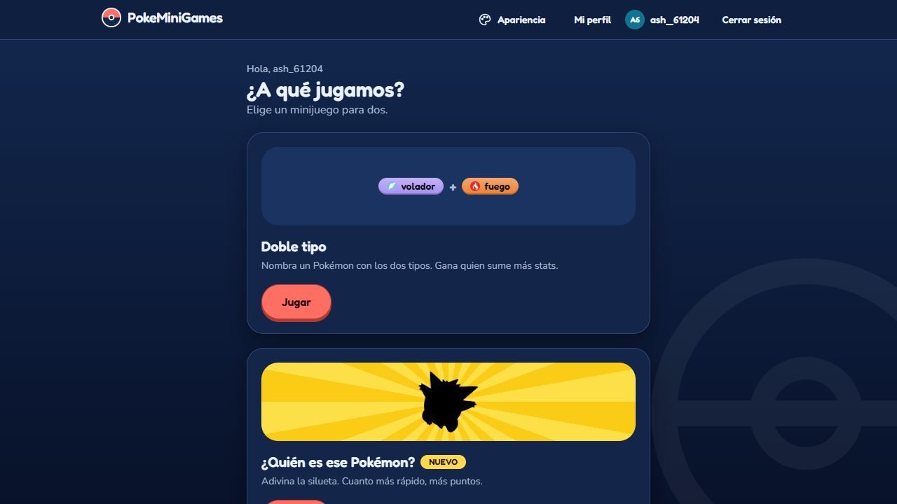
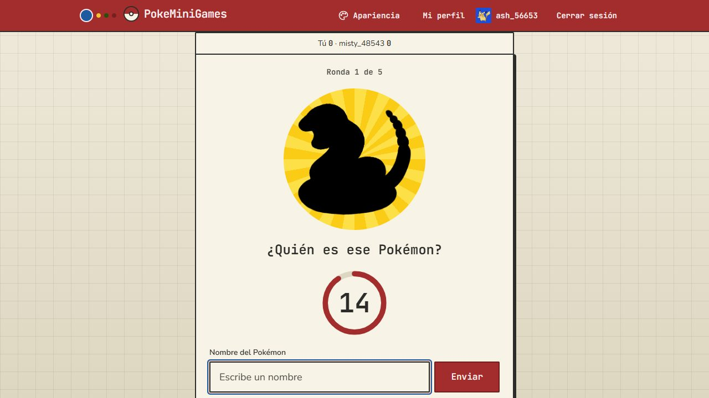
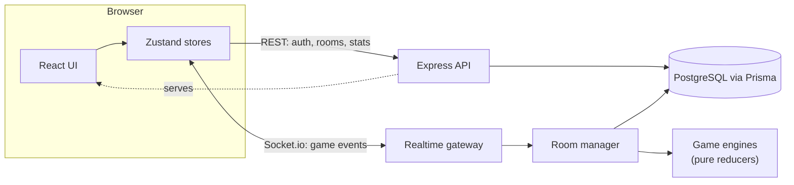

# PokeMiniGames

**Real-time Pokémon minigames for two players: challenge a friend 1 vs 1 from the browser.**

[](https://github.com/marcovinir/pokeminigames/actions/workflows/ci.yml)
[](https://pokemon-minigames.onrender.com)

[](LICENSE)

**[▶ Play it live](https://pokemon-minigames.onrender.com)** · [Leer en español](README.es.md) · [Technical guide (ES)](docs/guia-tecnica.md)

> The free hosting tier sleeps when idle: the first visit can take up to a minute to wake the server.



## The games

| | |
|---|---|
| **Doble tipo** | Each round shows a pair of types. Both players have 15 seconds to name a Pokémon that has both; whoever collects the most base stats wins. |
| **¿Quién es ese Pokémon?** | Both players see the same silhouette and get a single guess. The faster you answer, the more points you score. Pick the generations to play with. |

Create a room, share its code with a friend and play. No account needed (guest mode), or sign up for a profile with stats, match history and a Pokémon avatar. After a match, ask for a **rematch** with the same settings.

| | |
|---|---|
|  |  |
|  |  |


## Highlights

- **Real-time multiplayer** over Socket.io with a server-authoritative game engine written as a **pure reducer** (`state + event → state + effects`), so every rule is unit-testable with a fake clock.
- **Reconnection-safe:** reload mid-round and you return to your seat; a disconnected player gets a grace period.
- **Anti-cheat by design:** the silhouette is rendered on the server as a black PNG behind a random token, so the answer never reaches the browser.
- **Accounts done carefully:** short-lived access token kept in memory, rotating `HttpOnly` refresh cookie, per-IP rate limits, origin checks, and account deletion that anonymizes the user while keeping opponents' history intact.
- **Type chart:** a public page with a one- or two-type selector and the full 18 × 18 table, with every value tested against PokeAPI.
- **Sound:** original, freely licensed chiptune music for the lobby, the battle and the ending, plus 8-bit sound effects synthesized in the browser with the Web Audio API (no audio files), with a mute and volume panel.
- **Accessible UI:** two themes (Clásico and Pokédex) × light/dark, WCAG AA contrast checked in tests and in a real browser, keyboard focus rings, and a single rule that honors *reduce motion*.

## Tech stack

| Layer | Tools |
|---|---|
| Client | React 19, Vite, Tailwind CSS 4, Zustand, React Router |
| Server | Node.js 24, Express 5, Socket.io, Prisma 7, PostgreSQL 18, Zod |
| Shared | TypeScript package with the event contract, error codes and helpers used by both sides |
| Testing | Vitest + Testing Library, Playwright end-to-end with two real browsers |
| Delivery | GitHub Actions CI, Render (web service) + Neon (Postgres), both on free tiers |

## Architecture



A single Node service serves the built client, the REST API and Socket.io from one origin (no CORS, `SameSite=Lax` cookies). Game state lives in memory behind a `RoomStore` interface; finished matches are persisted for stats.

## How it was built

- **Spec → plan → TDD → independent review.** Every feature starts as a design spec and an implementation plan, both in [`docs/superpowers/`](docs/superpowers/). Each step is written test-first, critical guards are checked by breaking them on purpose (mutation testing), and every branch gets a final review with a fresh pair of eyes before merging.
- **About 1,800 automated tests** (server and client) plus **44 Playwright end-to-end tests** that play full matches in real browsers against the production build, including layout checks at phone widths.
- **Work tracked in [GitHub issues](https://github.com/marcovinir/pokeminigames/issues)** with a roadmap issue, and changes land through pull requests with green CI.
- **AI-assisted development:** built with Claude Code as a pair programmer. [`AGENTS.md`](AGENTS.md) documents the workflow and the rules any contributor, human or agent, follows.

## Run it locally

Requirements: Node.js 24+ and PostgreSQL 18 (no Docker needed).

```bash
npm install
cp server/.env.example server/.env          # then set DATABASE_URL and JWT_ACCESS_SECRET
npm run db:migrate -w server && npm run db:seed -w server
npm run dev          # game server on http://localhost:3000
npm run dev:client   # web client on http://localhost:5173
```

```bash
npm test             # server and client test suites
npm run typecheck    # tsc across all packages
npm run e2e          # builds and runs the Playwright suite
```

Full setup, every command, the REST API and the Socket.io events are in the [technical guide](docs/guia-tecnica.md); deployment to Render and Neon is in [`docs/despliegue.md`](docs/despliegue.md). Both are in Spanish.

## Project layout

| Folder | What's inside |
|---|---|
| `client/` | Web client |
| `server/` | REST API, realtime gateway, game engines, Prisma schema and migrations |
| `shared/` | Event contract and types shared by client and server |
| `e2e/` | Playwright end-to-end tests |
| `docs/` | Technical guide, deployment guide, design specs and plans |

## License

The code is released under the [MIT License](LICENSE).

PokeMiniGames is a non-profit **fan project**. Pokémon and its characters are trademarks of Nintendo, Game Freak and The Pokémon Company; this project is not affiliated with or endorsed by them. Pokémon artwork and data come from [PokeAPI](https://pokeapi.co).
